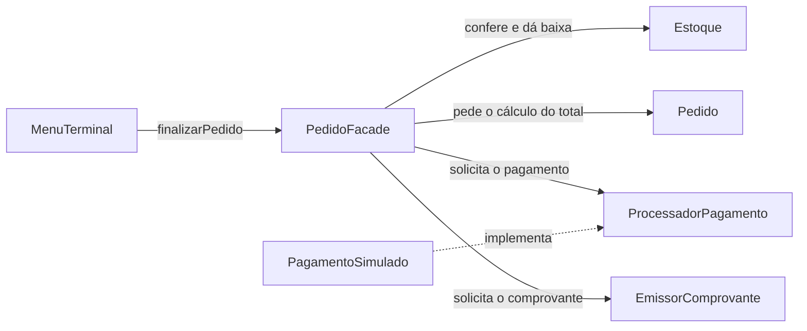

# Lanchonete APS 2

Sistema de pedidos em Java para o atendimento no balcão de uma lanchonete. O atendente consulta o cardápio e o estoque, monta o carrinho e fecha a venda pelo terminal. O projeto demonstra o padrão estrutural **Facade (Fachada)** no fechamento do pedido.

[Como executar](#como-executar) · [Facade no projeto](#facade-no-projeto) · [Princípios SOLID](#princípios-solid) · [Roteiro de apresentação](#roteiro-de-apresentação)

## O que o sistema faz

- Exibe o cardápio com preços e quantidades disponíveis.
- Adiciona produtos ao carrinho, soma quantidades do mesmo produto, permite remover produtos e calcula o total em reais.
- Simula pagamento por Pix e por cartão. O Pix é aprovado e o cartão aceita compras de até **R$ 30,00**.
- Emite um comprovante no terminal e atualiza o estoque quando o pagamento é aprovado.
- Preserva o carrinho e o estoque quando há falta de produto ou quando o pagamento é recusado.

O projeto roda localmente, com atendimento em um terminal por vez. O estoque é inicializado a cada execução. Os pagamentos são simulados e o comprovante serve para demonstrar a venda. Os valores são calculados com `BigDecimal` para manter a precisão dos centavos.

## Como executar

Requisitos para os comandos abaixo: **JDK 17 ou superior** e Git. Depois de clonar, compile e execute a partir da raiz do repositório.

```text
git clone https://github.com/marcondessimAO/aps2-lanchonete-facade.git
cd aps2-lanchonete-facade
```

**Windows (PowerShell)**

```powershell
$fontes = Get-ChildItem -Path src -Recurse -Filter *.java | ForEach-Object { $_.FullName }
javac --release 17 -encoding UTF-8 -d out $fontes
java -cp out br.edu.aps2.lanchonete.Main
```

**Linux ou macOS (Bash)**

```bash
find src -name '*.java' -exec javac --release 17 -encoding UTF-8 -d out {} +
java -cp out br.edu.aps2.lanchonete.Main
```

Em uma IDE, marque `src` como pasta de código-fonte, selecione um JDK 17 ou superior e execute a classe `Main`.

## Facade no projeto

A opção **Finalizar pedido** do menu representa uma operação que depende de vários componentes. Conferir o estoque antes do pagamento evita cobrar por um pedido que a lanchonete não consegue atender. A baixa só pode ocorrer após a aprovação. Essas regras de sequência estão concentradas em [`PedidoFacade`](src/br/edu/aps2/lanchonete/PedidoFacade.java).

O menu passa o pedido e a forma de pagamento, depois exibe o resultado e limpa o carrinho em caso de sucesso.

```java
ResultadoPedido resultado = fachada.finalizarPedido(new Pedido(carrinho), forma);
```



1. A fachada verifica se o pedido contém itens e se há estoque suficiente.
2. O pedido calcula o total e a fachada o encaminha ao processador de pagamento.
3. Se o pagamento for aprovado, a fachada solicita a baixa dos itens e a emissão do comprovante.
4. O menu recebe o resultado da operação. Em caso de recusa, o cliente pode corrigir o carrinho ou tentar outra forma de pagamento.

### Por que usar Facade

O fechamento tem uma sequência fixa, com regras que precisam ser respeitadas mesmo se futuramente houver outra interface, como um totem. A fachada dá ao menu uma operação de alto nível e permite que esse fluxo seja reaproveitado por outros clientes do sistema. O estoque continua sendo responsável pelas quantidades, `Pedido` calcula os valores e o processador decide se o pagamento é aprovado.

| Vantagens no projeto | Limitações e cuidados |
| --- | --- |
| O menu precisa conhecer apenas a chamada de fechamento e o seu resultado. | A fachada acrescenta uma classe e mantém dependências nos componentes que coordena. |
| A sequência de validação, pagamento, baixa e emissão fica em um só lugar. | Concentrar também os cálculos, as regras de pagamento e a formatação do comprovante na fachada a tornaria mais difícil de manter. |
| Outra interface pode usar o mesmo fluxo de venda. | Em uma operação que chamasse apenas um serviço simples, criar uma fachada poderia acrescentar código sem simplificar o cliente. |

### Outros padrões que poderiam ser usados

| Padrão | Onde se encaixaria |
| --- | --- |
| **Strategy** | Separar Pix e cartão em estratégias de pagamento se cada forma passar a ter regras próprias mais complexas. A fachada continuaria coordenando o fechamento. |
| **Adapter** | Traduzir a API de um provedor externo para o contrato `ProcessadorPagamento`. O provedor cuidaria da cobrança e a fachada continuaria responsável pela sequência da venda. |

Esses padrões tratam de partes específicas do fluxo. Facade é a escolha principal porque o problema deste trabalho é dar ao menu uma chamada simples para executar a venda inteira.

## Princípios SOLID

| Princípio | Aplicação no código |
| --- | --- |
| **S · Responsabilidade única** | `MenuTerminal` cuida da interação. `Pedido` calcula valores, `Estoque` controla quantidades e `EmissorComprovante` monta o comprovante. `PedidoFacade` coordena a venda. |
| **O · Aberto/fechado** | Uma segunda implementação de `ProcessadorPagamento` pode substituir a simulação na montagem feita por `Main`. O fluxo de `PedidoFacade.finalizarPedido()` permanece o mesmo. Esse ponto de extensão cobre processadores para as formas já aceitas. |
| **L · Substituição de Liskov** | Processadores são substituíveis se respeitarem o contrato da interface. Devem aceitar os valores positivos e as formas previstas e retornar `true` para pagamento aprovado ou `false` para recusa. A fachada usa esse resultado para decidir se pode baixar o estoque. |
| **I · Segregação de interfaces** | A interface de pagamento expõe só `processar(forma, valor)`. O checkout precisa apenas dessa operação e cada implementação implementa apenas esse contrato. |
| **D · Inversão de dependência** | `PedidoFacade` depende da abstração `ProcessadorPagamento` para decidir o andamento da venda. `Main` cria `PagamentoSimulado` e o injeta pelo construtor. |

Para mostrar **O** e **D** no código, abra [`Main`](src/br/edu/aps2/lanchonete/Main.java), [`ProcessadorPagamento`](src/br/edu/aps2/lanchonete/ProcessadorPagamento.java) e [`PedidoFacade`](src/br/edu/aps2/lanchonete/PedidoFacade.java). Um processador de teste pode retornar `false` para simular uma recusa usando a mesma fachada.

## Roteiro de apresentação

Comece com o sistema recém-aberto. Use a opção **1** para mostrar que o estoque começa com 8 hambúrgueres e 6 porções de batata.

| Demonstração | O que fazer | Resultado esperado |
| --- | --- | --- |
| **Venda aprovada** | Pela opção **2**, adicione 1 hambúrguer (código **1**) e 1 batata (código **2**). Use **5** para fechar e escolha **1** para Pix. | Comprovante de **R$ 23,50**, carrinho vazio, 7 hambúrgueres e 5 porções de batata no estoque. |
| **Pagamento recusado** | Adicione 3 hambúrgueres. Finalize com **5** e escolha **2** para cartão. Consulte o estoque com **1** e o carrinho com **3**. | O cartão recusa **R$ 45,00**. O estoque de hambúrgueres continua em 7 e o carrinho conserva as 3 unidades. |
| **Nova tentativa** | Finalize novamente o mesmo carrinho e escolha Pix. | Comprovante de **R$ 45,00**, carrinho vazio e 4 hambúrgueres no estoque. |
| **Estoque insuficiente** | Adicione 5 hambúrgueres e tente finalizar por Pix. | O sistema informa que há apenas 4 disponíveis. O pedido fica no carrinho e o estoque continua em 4. No código, a fachada retorna antes de chamar o pagamento. |

Após a demonstração, abra [`MenuTerminal`](src/br/edu/aps2/lanchonete/MenuTerminal.java) e mostre a chamada `finalizarPedido()`. Em seguida, abra a fachada e acompanhe o caso de recusa até o `return` que ocorre antes da baixa no estoque. Use esse mesmo trecho para explicar como a fachada coordena as responsabilidades e como a interface de pagamento permite substituir o simulador.
