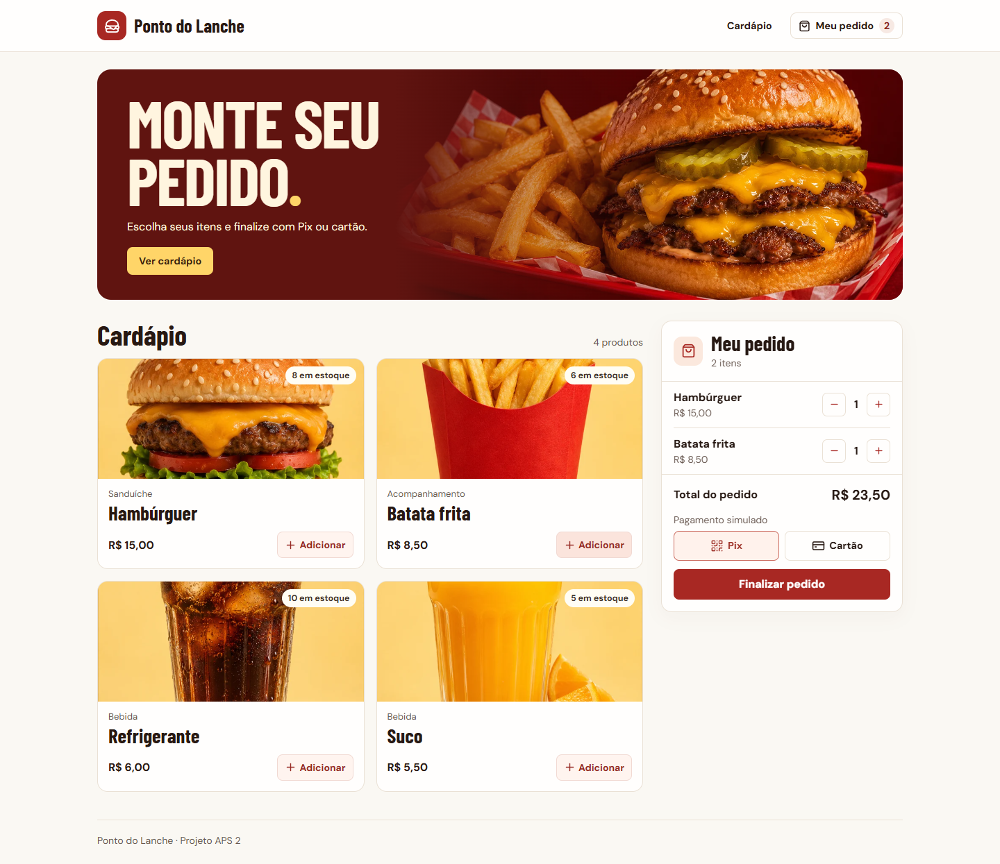
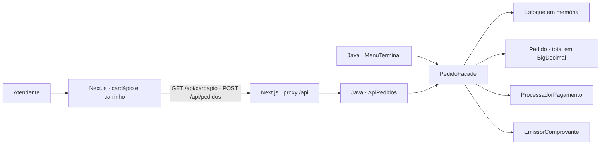
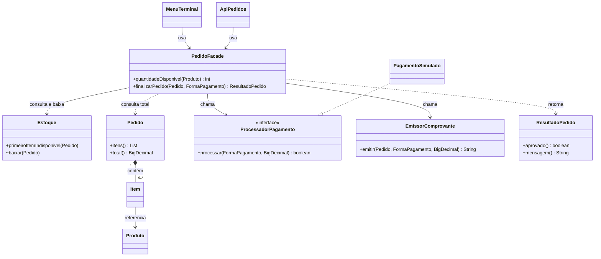
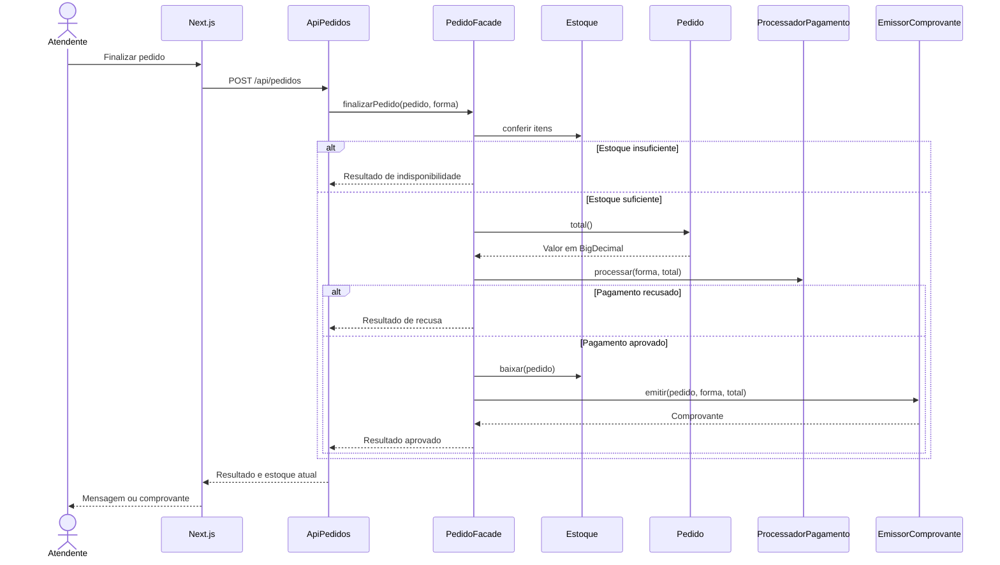

# Ponto do Lanche · APS 2

Balcão digital de uma lanchonete. A interface em **Next.js** exibe o cardápio e o estoque, permite montar o carrinho e mostra o comprovante. O **Java** valida os itens, calcula o valor da venda, simula o pagamento e dá baixa no estoque. O padrão estrutural **Facade** concentra a sequência dessas operações em `PedidoFacade.finalizarPedido()`.

[Executar](#executar) · [Arquitetura](#arquitetura) · [Facade](#por-que-facade) · [SOLID](#solid-no-código) · [API](#api-http) · [Apresentação](#roteiro-de-apresentação)



## O que dá para demonstrar

- Consultar preços e quantidades, adicionar e remover itens e acompanhar o total do carrinho.
- Pagar com Pix ou cartão simulados. O Pix aprova pedidos válidos e o cartão aceita até **R$ 30,00 por compra**.
- Ver o comprovante e o estoque atualizado após uma aprovação. Uma recusa mantém o carrinho disponível para nova tentativa.
- Abrir dois navegadores ou abas para observar o mesmo estoque do servidor. O Java confere a disponibilidade no momento da compra.

O sistema roda localmente. A API guarda o estoque em memória e recomeça com 8 hambúrgueres, 6 porções de batata, 10 refrigerantes e 5 sucos sempre que o processo Java reinicia.

## Executar

Instale **JDK 17 ou superior**, **Node.js 20.9 ou superior** e Git. Execute os comandos em **dois terminais**.

```bash
git clone https://github.com/marcondessimAO/aps2-lanchonete-facade.git
cd aps2-lanchonete-facade
```

### Terminal 1 · API Java

Na raiz do repositório, compile e suba a API na porta `8080`.

**Windows (PowerShell)**

```powershell
$fontes = Get-ChildItem -Path src -Recurse -Filter *.java | ForEach-Object { $_.FullName }
javac --release 17 --add-modules jdk.httpserver -encoding UTF-8 -d out $fontes
java --add-modules jdk.httpserver -cp out br.edu.aps2.lanchonete.ApiPedidos
```

**Linux ou macOS (Bash)**

```bash
find src -name '*.java' -exec javac --release 17 --add-modules jdk.httpserver -encoding UTF-8 -d out {} +
java --add-modules jdk.httpserver -cp out br.edu.aps2.lanchonete.ApiPedidos
```

Para conferir se o Java está rodando, abra [o endpoint do cardápio](http://127.0.0.1:8080/api/cardapio). Ele deve retornar JSON com quatro produtos.

### Terminal 2 · Interface Next.js

Abra outro terminal na raiz do repositório.

```bash
cd web
npm ci
npm run dev
```

Abra [http://127.0.0.1:3000](http://127.0.0.1:3000). Mantenha os dois processos em execução. Para usar a versão compilada da interface, execute `npm run build` seguido de `npm start` dentro de `web`.

Se precisar trocar a porta da API, acrescente a porta ao comando da classe `ApiPedidos` e defina `API_JAVA_URL` no ambiente do Next.js antes de iniciar o modo de desenvolvimento ou gerar o build. Um exemplo de valor é `http://127.0.0.1:8081`.

### Versão de terminal

Depois de compilar o Java, execute na raiz:

```bash
java -cp out br.edu.aps2.lanchonete.Main
```

Essa versão é executada em outro processo e tem seu próprio estoque em memória. Ela demonstra a mesma fachada com um segundo tipo de interface.

## Arquitetura



| Camada | Arquivo | Responsabilidade |
| --- | --- | --- |
| Interface web | [page.jsx](web/app/page.jsx) | Exibe o cardápio, mantém o carrinho e mostra a resposta da venda. |
| Proxy | [next.config.mjs](web/next.config.mjs) | Encaminha as chamadas `/api/*` do navegador ao servidor Java. |
| HTTP em Java | [ApiPedidos.java](src/br/edu/aps2/lanchonete/ApiPedidos.java) | Valida o formato da requisição, monta o pedido e devolve JSON. |
| Aplicação | [PedidoFacade.java](src/br/edu/aps2/lanchonete/PedidoFacade.java) | Coordena o fechamento do pedido. |
| Domínio | [Pedido.java](src/br/edu/aps2/lanchonete/Pedido.java), [Estoque.java](src/br/edu/aps2/lanchonete/Estoque.java) | Calcula os valores com `BigDecimal` e controla as quantidades. |

### Diagrama de classes



### Sequência do checkout



## Por que Facade

O checkout tem uma ordem que as duas interfaces precisam respeitar. O estoque é conferido antes de solicitar o pagamento. A baixa e a emissão ocorrem após a aprovação. Tanto o menu quanto a API chamam o mesmo método, que coordena essa ordem:

```java
ResultadoPedido resultado = fachada.finalizarPedido(pedido, forma);
```

- **Vantagem.** A interface pede o fechamento inteiro com uma chamada e recebe um `ResultadoPedido`. As regras de preço, estoque e pagamento ficam nos componentes responsáveis por elas.
- **Vantagem.** O fluxo pode evoluir em um só lugar. Por exemplo, incluir uma etapa de confirmação entre pagamento e comprovante pode exigir mudanças apenas na fachada e no componente que executa a nova etapa.
- **Limitação.** A fachada depende dos componentes que coordena. Se acumular cálculo monetário, formatação e regras de cobrança, cresce e passa a ter vários motivos para mudar.
- **Limitação.** Em uma operação que usa um único componente sem etapas de coordenação, uma fachada pode acrescentar uma chamada com pouco benefício.

| Outro padrão | Onde seria útil neste projeto |
| --- | --- |
| **Strategy** | Escolher entre algoritmos separados de Pix e cartão caso as regras de cada forma cresçam. Hoje o simulador tem duas regras simples. A fachada trata a sequência completa da venda. |
| **Adapter** | Encaixar uma API de cobrança externa no contrato de `ProcessadorPagamento`, traduzindo a entrada e o retorno do provedor. |
| **Command** | Representar a solicitação de compra como objeto em um cenário futuro com fila ou processamento assíncrono. O fechamento local é síncrono. |

## SOLID no código

| Princípio | Exemplo no projeto |
| --- | --- |
| **S · Responsabilidade única** | `ApiPedidos` trata HTTP. `Pedido` calcula valores, `Estoque` controla unidades e `EmissorComprovante` gera o comprovante. `PedidoFacade` decide a ordem das chamadas. |
| **O · Aberto/fechado** | Uma implementação nova de `ProcessadorPagamento` pode ser ligada em [Configuracao.java](src/br/edu/aps2/lanchonete/Configuracao.java) sem editar o fluxo da fachada. O exemplo vale para as formas que o contrato já conhece. |
| **L · Substituição de Liskov** | Um processador substituto deve aceitar as formas previstas e os valores positivos e retornar `true` só ao aprovar. A fachada conserva o mesmo comportamento para aprovação e recusa. |
| **I · Segregação de interfaces** | [ProcessadorPagamento](src/br/edu/aps2/lanchonete/ProcessadorPagamento.java) oferece um contrato de uma operação, `processar(forma, valor)`, suficiente para o checkout. |
| **D · Inversão de dependência** | A fachada recebe `ProcessadorPagamento` no construtor. A configuração cria `PagamentoSimulado` e o injeta. |

## API HTTP

| Requisição | Resultado |
| --- | --- |
| `GET /api/cardapio` | Lista de objetos com `id`, `nome`, `precoCentavos` e `estoque`. |
| `POST /api/pedidos` | Recebe formulário com UUID em `tentativa`, `pagamento` (`PIX` ou `CARTAO`) e quantidades por código de produto. Retorna `aprovado`, `mensagem` e a lista atualizada de `produtos`. |

O exemplo abaixo gera um identificador e realiza uma **venda de teste**, consumindo uma unidade de hambúrguer. Execute em Bash com a API ativa e `uuidgen` disponível.

```bash
curl http://127.0.0.1:8080/api/pedidos \
  --data "tentativa=$(uuidgen)&pagamento=PIX&HAMBURGUER=1"
```

Aprovação, falta de estoque ou recusa de pagamento são resultados de negócio e retornam HTTP 200. Dados de entrada inválidos retornam HTTP 400. A API processa uma requisição por vez para manter a conferência e a baixa em sequência. Se a resposta de uma venda aprovada se perder, repetir a mesma tentativa com os mesmos dados no mesmo processo devolve o comprovante sem uma nova baixa. Reutilizar o identificador de uma venda aprovada com dados diferentes retorna HTTP 409.

## Roteiro de apresentação

Reinicie a API antes de começar. O cardápio deve mostrar 8 hambúrgueres e 6 porções de batata.

| Passo | Demonstração | Resultado esperado |
| --- | --- | --- |
| **1. Aprovação** | Adicione 1 hambúrguer e 1 batata. Finalize via Pix. | Comprovante de **R$ 23,50**, carrinho zerado, 7 hambúrgueres e 5 batatas em estoque. |
| **2. Recusa** | Adicione 3 hambúrgueres e finalize com cartão. | O cartão recusa **R$ 45,00**. O carrinho mantém os 3 itens e o estoque continua em 7. |
| **3. Nova tentativa** | Selecione Pix e finalize o mesmo carrinho. | Comprovante de **R$ 45,00**, carrinho zerado e 4 hambúrgueres em estoque. |
| **4. Estoque disputado** | Abra duas abas depois do passo 3. Monte 4 hambúrgueres na primeira aba e 1 na segunda. Finalize a segunda por Pix e depois tente fechar a primeira. | A primeira aba avisa que só existem **3 unidades** e mantém o carrinho para ajuste. |
| **5. Código** | Abra `ApiPedidos.finalizar()` e `PedidoFacade.finalizarPedido()`. | Mostre que a fachada retorna antes de chamar o pagamento se faltar estoque e que um pagamento recusado impede a baixa. |

Para explicar SOLID, use o construtor de `PedidoFacade` e o ponto de montagem em `Configuracao` para mostrar como o simulador pode ser substituído. Use a divisão entre `Pedido`, `Estoque` e `EmissorComprovante` para mostrar as responsabilidades de cada classe.

### Referências técnicas

- [Next.js · rewrites](https://nextjs.org/docs/app/api-reference/config/next-config-js/rewrites)
- [Java 17 · HttpServer](https://docs.oracle.com/en/java/javase/17/docs/api/jdk.httpserver/com/sun/net/httpserver/HttpServer.html)
- Imagens ilustrativas geradas com ImageGen. A [foto do balcão](web/public/balcao.webp) mostra um hambúrguer com batatas. A [composição do cardápio](web/public/produtos.webp) reúne hambúrguer, batata frita, refrigerante e suco.
